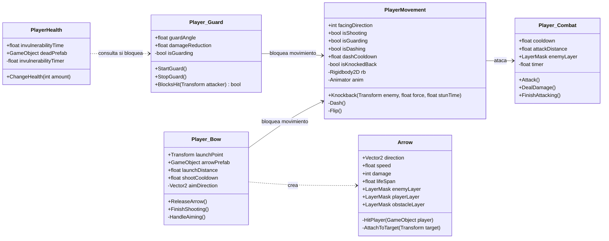
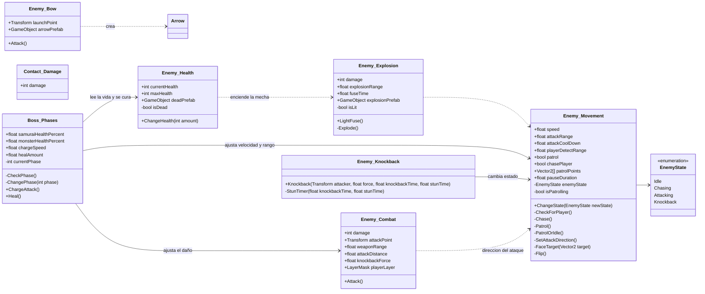
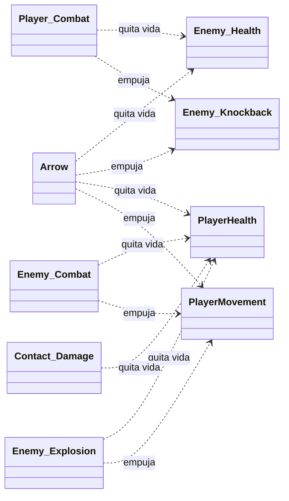
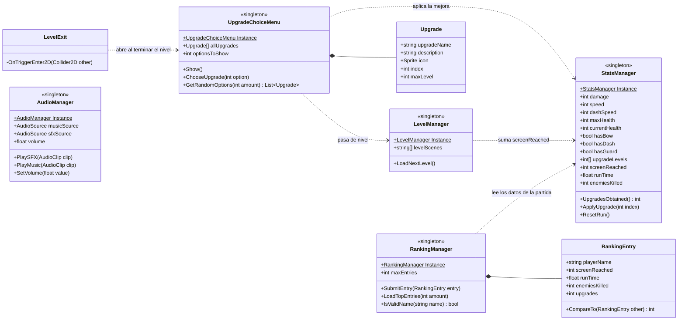
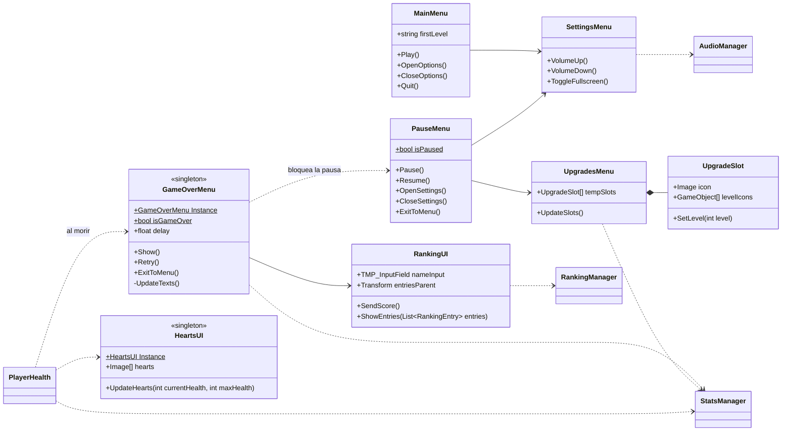

# Diagrama de clases — Hyrulike

Todas las clases heredan de `MonoBehaviour` salvo `EnemyState`, `Upgrade` y `RankingEntry` (no se dibuja la herencia para no cargar el diagrama).
Leyenda de relaciones: `-->` usa/tiene una referencia, `..>` depende de (llama o crea), `*--` composición.

## 1. Jugador

## 2. Enemigos y jefe

El jefe no tiene una clase "Boss" propia: es un prefab con los mismos componentes que los enemigos (`Enemy_Movement`, `Enemy_Combat`, `Enemy_Health`, `Enemy_Knockback`) más `Boss_Phases`, que lo hace cambiar de forma (Monje → Samurái → Monstruo) al bajar de vida y añade la curación y el ataque cargado.

## 3. Interacción jugador ↔ enemigos

## 4. Partida, niveles, ranking y sonido

El ranking ordena por `screenReached` (de más a menos) y, si empatan, por `runTime` (de menos a más). `enemiesKilled` y `upgrades` son solo informativos. Esa comparación es `RankingEntry.CompareTo`.

## 5. Interfaz

